# User Manual Website Rempang Eco City

Panduan penggunaan website **Rempang Eco City** untuk pengunjung, admin konten, dan developer.

| | |
|---|---|
| Alamat website | **https://rempang-eco-city.com** (aktif mulai 20 November 2026) |
| Alamat CMS (Studio) | **https://rempang-eco-city.com/studio** |
| Repositori kode | https://github.com/rempang-eco-city/rempang-eco-city |

> Sebelum 20 November 2026, gunakan alamat sementara yang sedang dipakai. Cukup ganti bagian domainnya; semua halaman dan `/studio` tetap sama.

**Daftar isi**

- [Bagian A: Pengunjung Website](#bagian-a-pengunjung-website)
- [Bagian B: Admin Konten (Sanity Studio)](#bagian-b-admin-konten-sanity-studio)
- [Bagian C: Developer](#bagian-c-developer)

---

# Bagian A: Pengunjung Website

## A1. Sekilas Rempang Eco City

Website ini adalah portal informasi masyarakat Rempang Eco City (REC). Isinya profil kawasan, koperasi, pariwisata, UMKM, berita, dan peta interaktif kawasan perumahan.

Menu utama ada di bagian atas setiap halaman: **Beranda**, **Profil REC**, **Koperasi**, **Pariwisata**, **UMKM**, dan **Berita**. Di HP, menu dibuka lewat tombol ☰ di pojok kanan atas.

## A2. Halaman-halaman

### Beranda


Beranda berisi ringkasan seluruh website, dari atas ke bawah:

1. **Hero**: judul, deskripsi, dan tombol menuju halaman lain.
2. **Peta Wilayah**: peta interaktif (lihat [A3](#a3-memakai-peta-interaktif)).
3. **Koperasi**: card Koperasi Transmigrasi dan Koperasi Merah Putih.
4. **Pariwisata**: carousel foto wisata.
5. **UMKM**: daftar UMKM pilihan.
6. **Berita**: 4 berita, berita *featured* didahulukan.
7. **Ikuti Kami di Instagram**: card akun Instagram, dibuka di tab baru.

### Profil REC

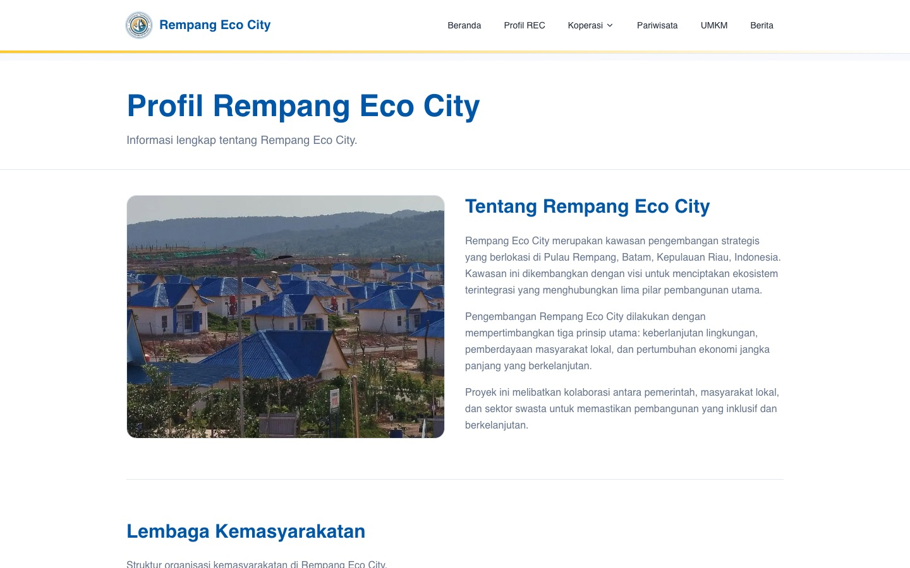

Berisi tentang Rempang Eco City, lembaga kemasyarakatan, fasilitas (deretan foto bergerak), dan data demografi.

### Koperasi

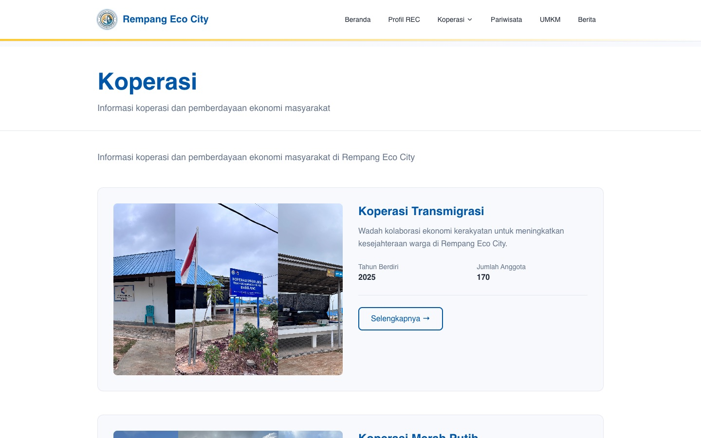

Halaman **Koperasi** menampilkan semua koperasi. Klik salah satu untuk membuka halaman detailnya (`/koperasi/transmigrasi` atau `/koperasi/merah-putih`).

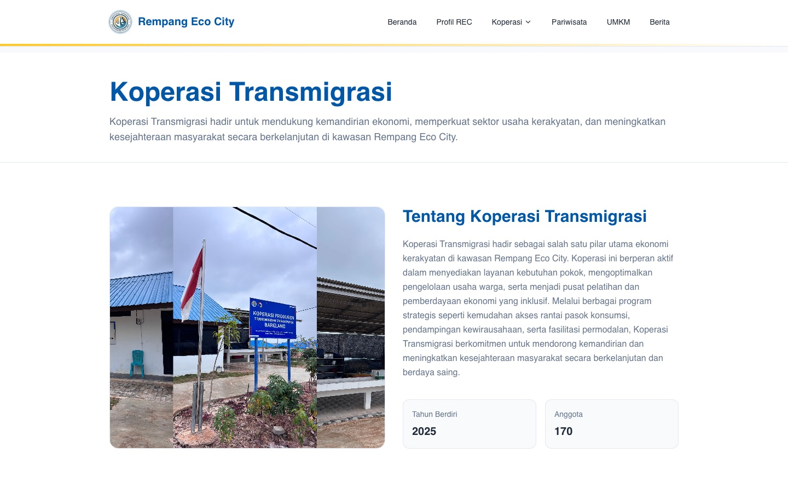

Halaman detail koperasi berisi:

- tentang koperasi, tahun berdiri, dan jumlah anggota;
- **struktur kepengurusan** dalam bentuk bagan;
- foto pengurus;
- ajakan menjadi anggota, dengan tombol **Hubungi via WhatsApp**;
- fasilitas dan layanan;
- galeri kegiatan;
- **laporan keuangan**. Klik laporan untuk membukanya di tab baru. PDF dibuka langsung, sedangkan Excel dan Word ditampilkan lewat Microsoft Office Online.


### Pariwisata

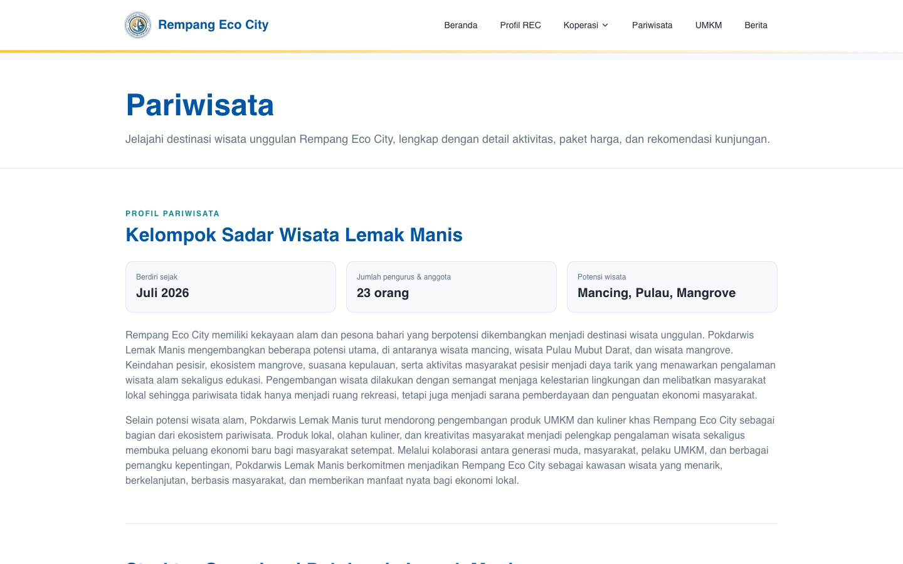

Berisi profil Pokdarwis (Kelompok Sadar Wisata), struktur organisasi, pengurus, dan **destinasi wisata**.

Pilih destinasi lewat tombol tab. Setiap destinasi menampilkan:

- galeri foto dan video;
- deskripsi, fasilitas, dan tips;
- **paket dan harga** beserta rincian biaya dan Total Akomodasi;
- tombol **Hubungi Pengelola Wisata** (WhatsApp).


### UMKM

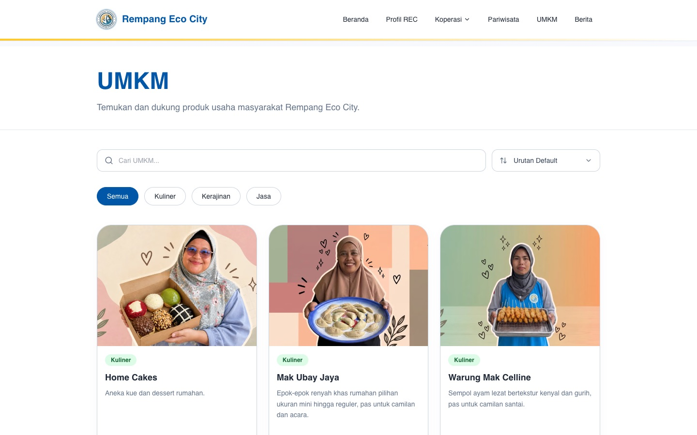

Daftar usaha warga. Fitur yang tersedia:

- **Cari UMKM...**: cari berdasarkan nama.
- **Filter kategori**: Semua, Kuliner, Kerajinan, Jasa.
- **Urutkan**: berdasarkan nama A–Z atau Z–A.

Klik **Lihat Detail UMKM** untuk melihat produk, galeri, pemilik, lokasi, dan tombol **Hubungi via WhatsApp** atau **Shopee**.

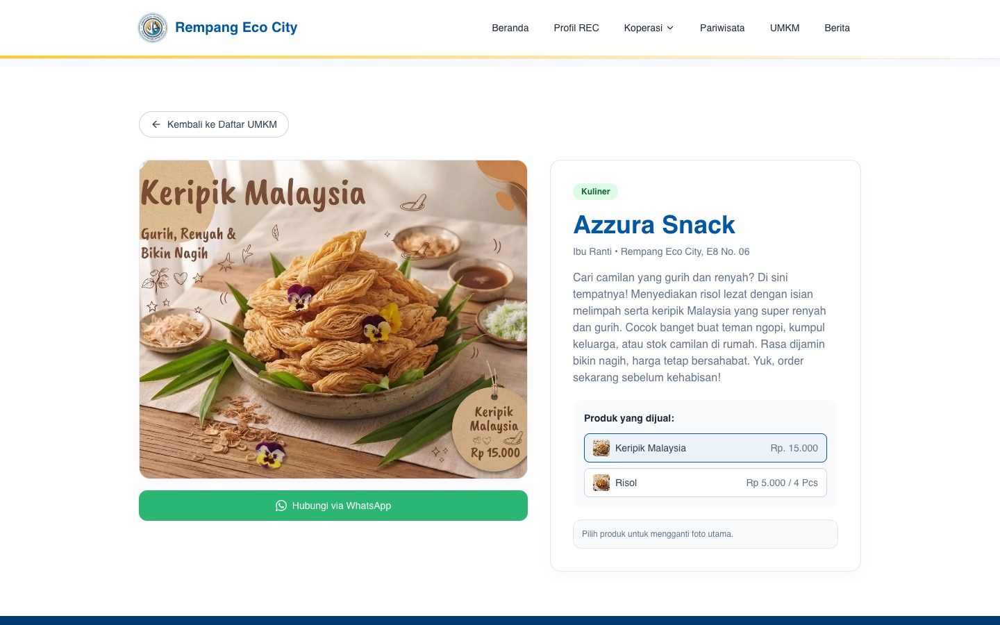

### Berita

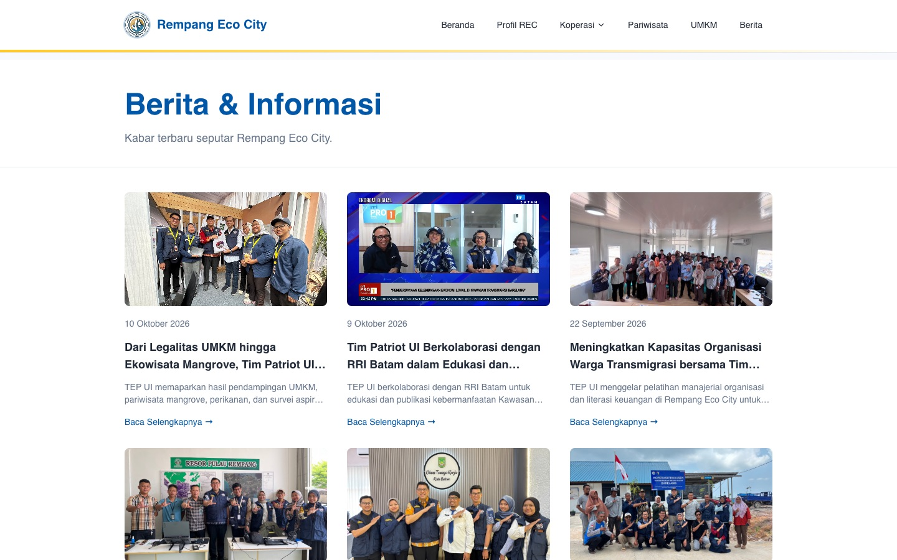

Berita diurutkan dari yang terbaru. Klik berita untuk membaca isi lengkapnya.

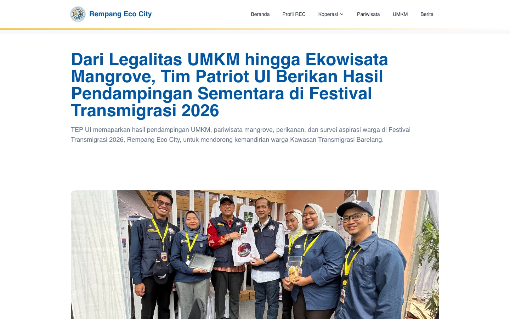

## A3. Memakai peta interaktif


Peta di Beranda menampilkan tempat-tempat di kawasan perumahan relokasi.

| Kontrol | Fungsi |
|---|---|
| **+ / −** | Memperbesar / memperkecil. Zoom dengan scroll mouse aktif setelah peta diklik. |
| **Satelit / Peta / Google** | Ganti tampilan. *Satelit*: foto udara (citra lama, sebelum pembangunan). *Peta*: peta jalan OpenStreetMap. *Google*: citra satelit Google yang lebih baru, tetapi titik lokasi, blok rumah, dan Tanjakan tidak bisa ditampilkan di mode ini. |
| **Tanjakan** | Mewarnai kemiringan lahan, dari hijau (datar) sampai merah (curam). Ini perkiraan dari data elevasi satelit, bukan hasil ukur jalan. |
| **Blok Rumah** | Menampilkan garis blok perumahan (A2, B3, C4, dst.). Nama blok muncul saat peta diperbesar, dan nomor rumah saat diperbesar lebih jauh. Klik blok untuk melihat jumlah rumahnya. |
| **Tempat di Sekitar** (panel kanan; di HP di bawah peta) | Daftar semua tempat. Klik chip kategori untuk memfilter (misalnya Warung Makan, Masjid / Mushola, Sekolah). |

**Melihat detail tempat.** Klik ikon di peta atau nama tempat di daftar. Panel akan menampilkan foto, kategori, keterangan, dan tombol:

- **Petunjuk Arah**: membuka rute di Google Maps.
- **Lihat Detail**: muncul jika tempat itu punya halaman di website ini.

Klik **← Semua tempat** untuk kembali ke daftar.

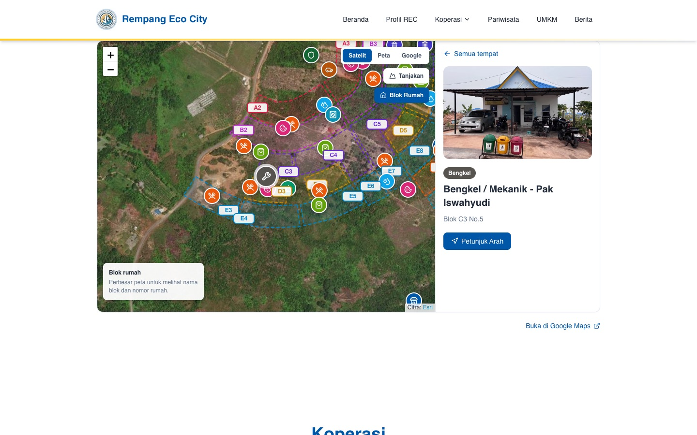

Tautan **Buka di Google Maps** di bawah peta membuka lokasi kawasan di Google Maps.

## A4. Menghubungi UMKM dan mengikuti Instagram

- **UMKM, koperasi, dan wisata**: gunakan tombol WhatsApp di halaman detailnya.
- **Instagram**: section paling bawah Beranda. Klik card akun untuk membuka profil Instagram-nya di tab baru.

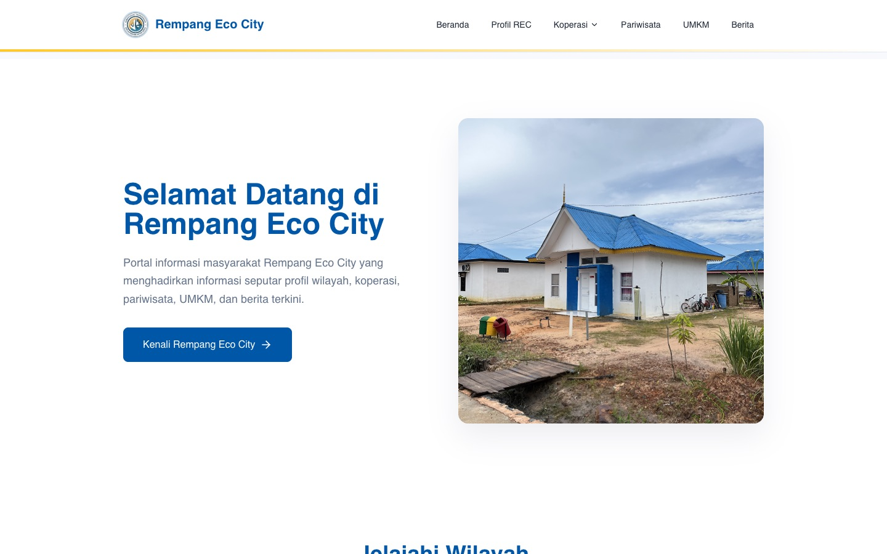

---

# Bagian B: Admin Konten (Sanity Studio)

Semua isi website (teks, foto, daftar, peta) dikelola lewat **Sanity Studio**. Tidak perlu mengubah kode.

## B1. Masuk ke Studio

1. Buka **https://rempang-eco-city.com/studio**.
2. Login dengan akun yang sudah diundang ke project Sanity (Google, GitHub, atau email).
3. Belum punya akses? Minta pemilik project mengundang Anda lewat [sanity.io/manage](https://www.sanity.io/manage) → pilih project → **Members** → **Invite**.

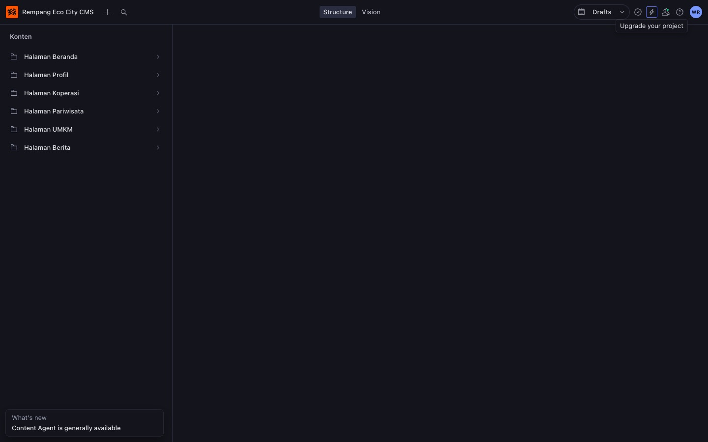

Menu **Konten** di kiri berisi:

| Menu | Isi |
|---|---|
| **Halaman Beranda** | *Konten Halaman* (teks dan gambar Beranda) dan *Lokasi di Peta* |
| **Halaman Profil** | Isi halaman Profil |
| **Halaman Koperasi** | Satu dokumen per koperasi |
| **Halaman Pariwisata** | Profil Pokdarwis dan destinasi wisata |
| **Halaman UMKM** | *Header Halaman* dan *Daftar UMKM* |
| **Halaman Berita** | *Header Halaman* dan *Daftar Berita* |

## B2. Dasar-dasar

**Draft dan Publish**

- Setiap perubahan otomatis tersimpan sebagai **Draft**. Draft belum terlihat di website.
- Klik tombol **Publish** (kanan bawah) agar perubahan tampil di website.
- Label **Published** / **Draft** di atas dokumen menunjukkan versi mana yang sedang dilihat.

**Kapan perubahan muncul?** Paling lama sekitar **1 menit** setelah Publish. Kalau belum terlihat, muat ulang halaman (Ctrl+R / Cmd+R).

**Kolom wajib dan peringatan**

- Kolom bertanda merah wajib diisi atau isinya salah format. Dokumen tidak bisa di-Publish sebelum diperbaiki.
- Tanda kuning hanya peringatan. Contohnya koordinat di luar area Rempang, atau total paket yang berbeda dari rinciannya. Dokumen tetap bisa di-Publish.

**Gambar**

- Klik kolom gambar → **Upload** atau seret file ke kolom.
- Gunakan JPG/PNG. Hindari HEIC (format foto iPhone); ubah dulu ke JPG.
- Ikon ✂︎ **crop/hotspot** dipakai untuk menandai bagian penting foto, supaya tidak terpotong saat ditampilkan.

**Daftar (list)**

- Klik **+ Add item** untuk menambah.
- Seret ikon ⋮⋮ untuk mengubah urutan.
- Menu ⋯ pada item untuk menghapus.

**Menghapus dokumen**: buka dokumen → menu ⋯ (kanan bawah, di sebelah Publish) → **Delete**.

## B3. Halaman Beranda

### Konten Halaman

Buka **Halaman Beranda → Konten Halaman**. Isinya dibagi per tab sesuai section Beranda.

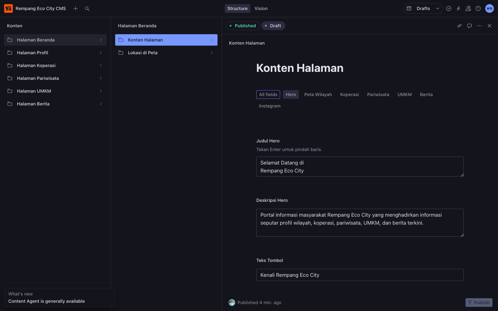

| Tab | Kolom | Keterangan |
|---|---|---|
| **Hero** | Judul Hero | Tekan Enter untuk pindah baris. |
| | Deskripsi Hero, Teks Tombol, Gambar Hero | — |
| | Link Tombol | Halaman di website ini (contoh `/profil`) atau link lengkap `https://...`. |
| **Peta Wilayah** | Judul Peta, Deskripsi Peta | Titik di peta diisi lewat menu *Lokasi di Peta*. |
| | Alamat / Lokasi di Google Maps | Dipakai tombol "Buka di Google Maps". Bisa alamat atau Plus Code. |
| **Koperasi** | Judul Section Koperasi | Card diambil otomatis dari *Halaman Koperasi*. |
| **Pariwisata** | Judul, Deskripsi, Foto Carousel | Minimal 1 foto. |
| **UMKM** | Judul, Deskripsi | Card diambil otomatis dari *Daftar UMKM*. |
| **Berita** | Judul Section Berita | Card diambil dari *Daftar Berita* (lihat [Featured](#featured-di-beranda)). |
| **Instagram** | Judul, Deskripsi, Akun Instagram | Lihat di bawah. |

**Akun Instagram** (tab Instagram, maksimal 6 akun):

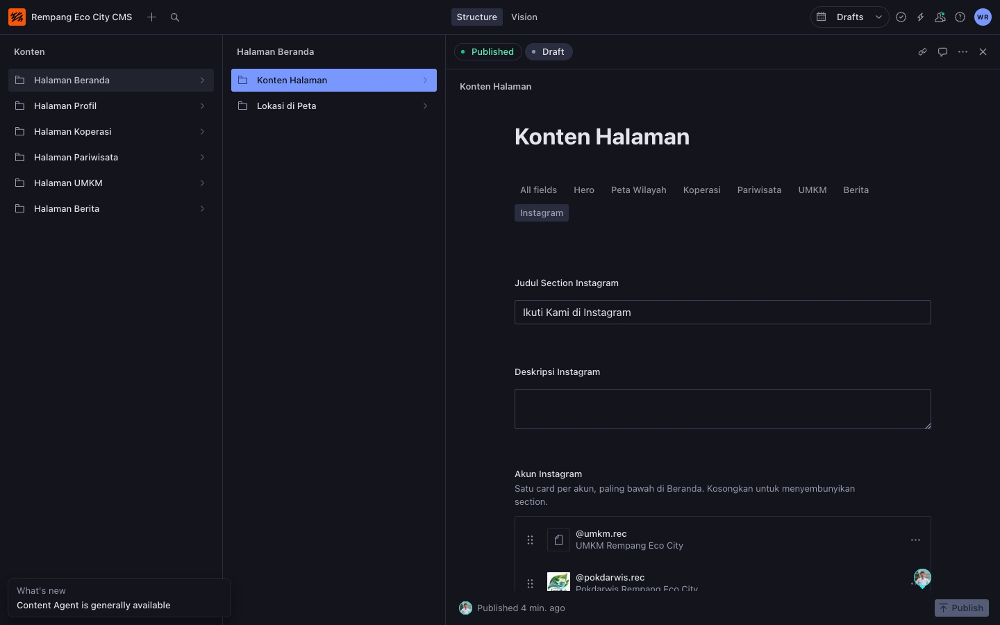

- **Username**: tanpa "@" dan tanpa link, contoh `umkm.rec`.
- **Foto Profil (opsional)**: gambar persegi. Kalau kosong, tampil logo Instagram.
- **Nama (opsional)**: kalau kosong, card hanya menampilkan @username.
- **Deskripsi Singkat (opsional)**: maksimal 140 karakter.
- Kosongkan seluruh daftar untuk menyembunyikan section Instagram.

> Foto profil tidak bisa diambil otomatis dari Instagram. Jika foto profil di Instagram berganti, unggah ulang di sini.

### Lokasi di Peta

Buka **Halaman Beranda → Lokasi di Peta**. Setiap dokumen adalah satu titik di peta.

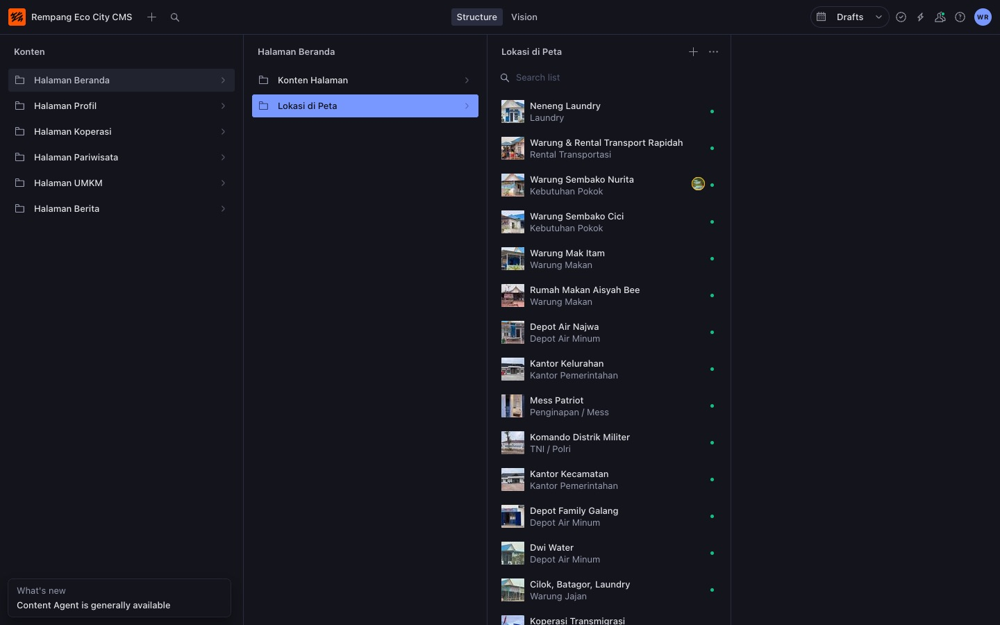

**Menambah lokasi**

1. Klik **+** di atas daftar.
2. Isi **Nama Tempat**, misalnya "Warung Makan Bu Siti".
3. Pilih **Kategori**. Kategori menentukan ikon, warna, dan filter di peta.
4. Isi **Koordinat**:
   1. Buka Google Maps dan cari tempatnya.
   2. **Klik kanan tepat di lokasinya**, lalu klik angka koordinat paling atas. Angka otomatis tersalin.
   3. Tempel di kolom Koordinat. Formatnya `lintang, bujur`, contoh `0.81425, 104.22475`.
5. Opsional:
   - **Foto**.
   - **Keterangan**: maksimal 240 karakter, contoh "Blok C3 No.5", jam buka, atau menu andalan.
   - **Link Halaman Terkait**: contoh `/umkm/warung-akbar`. Akan muncul sebagai tombol "Lihat Detail".
6. Klik **Publish**.

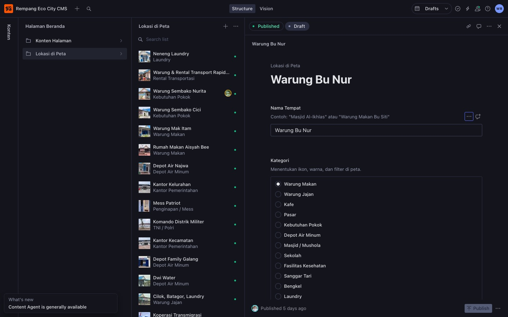

**Kategori yang tersedia**: Warung Makan, Warung Jajan, Kafe, Pasar, Kebutuhan Pokok, Depot Air Minum, Masjid / Mushola, Sekolah, Fasilitas Kesehatan, Sanggar Tari, Bengkel, Laundry, Rental Transportasi, Koperasi, Kantor Pemerintahan, TNI / Polri, Penginapan / Mess, Kampung Nelayan, Dermaga, Lainnya.

> Butuh kategori baru? Untuk sementara pakai **Lainnya**, lalu minta developer menambahkannya (lihat [C4](#c4-perubahan-yang-sering-dibutuhkan)).

> Di link Google Maps yang dibagikan (`maps.app.goo.gl/...`), angka setelah `@` adalah posisi tampilan layar, bukan posisi tempatnya. Selalu gunakan cara **klik kanan** di atas.

## B4. Halaman Profil

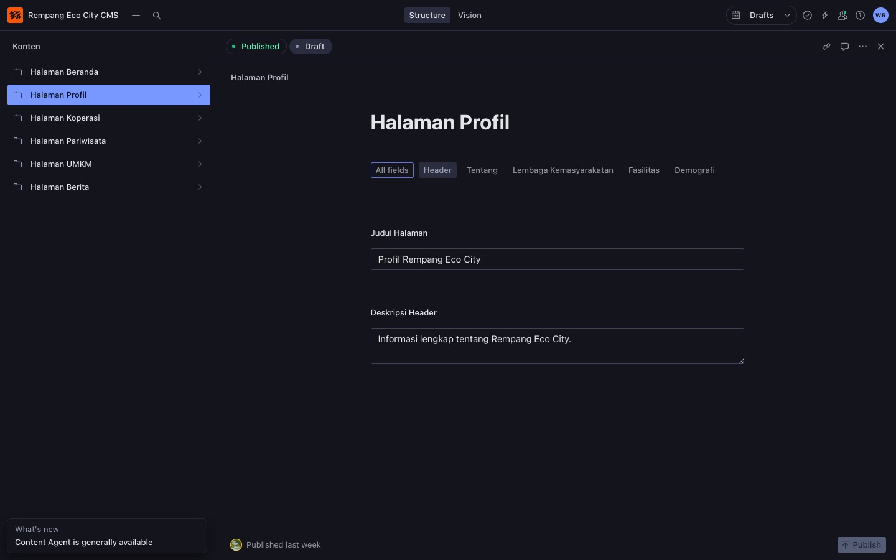

| Tab | Isi |
|---|---|
| **Header** | Judul dan deskripsi halaman |
| **Tentang** | Judul, foto, dan isi |
| **Lembaga Kemasyarakatan** | Judul, deskripsi, dan daftar lembaga (nama, deskripsi, foto wajib) |
| **Fasilitas** | Daftar fasilitas (nama dan foto, rasio 4:3 paling cocok). Ditampilkan sebagai deretan foto bergerak. Fasilitas tanpa foto tidak tampil. |
| **Demografi** | Daftar data (Label + Nilai, contoh "Total Penduduk" / "12.450") dan Catatan. Catatan tampil di kotak kuning; kosongkan untuk menyembunyikan. |

## B5. Halaman Koperasi

Buka **Halaman Koperasi**, lalu pilih koperasi.

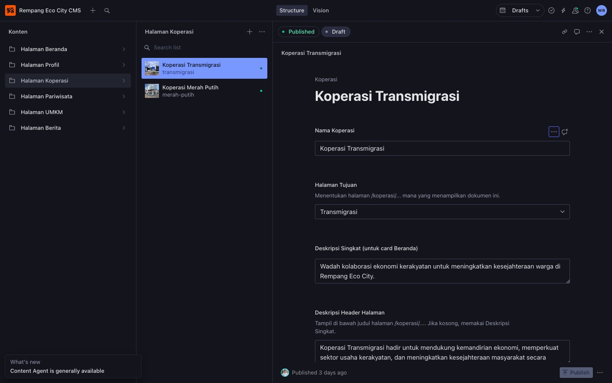

| Kolom | Keterangan |
|---|---|
| Nama Koperasi | — |
| Halaman Tujuan | `transmigrasi` atau `merah-putih`. Menentukan alamat halamannya. |
| Deskripsi Singkat | Untuk card di Beranda, maksimal 160 karakter. |
| Deskripsi Header Halaman | Kalau kosong, memakai Deskripsi Singkat. |
| Foto Utama, Deskripsi Tentang, Tahun Berdiri, Jumlah Anggota | Wajib. |
| **Struktur Kepengurusan** | Bagan dibuat otomatis (lihat di bawah). |
| Gambar Struktur (cadangan) | Hanya dipakai jika Struktur Kepengurusan kosong. |
| Pengurus | Foto pengurus (nama, jabatan, foto). |
| Keanggotaan | Deskripsi dan **Link WhatsApp Pendaftaran** (format `https://wa.me/628xxxxxxxxxx`). Section ini hanya tampil jika link diisi. |
| Fasilitas, Layanan | Section disembunyikan jika kosong. Layanan punya pilihan ikon dan Poin Keunggulan (maksimal 6). |
| Galeri Kegiatan | Judul, deskripsi, dan minimal 1 foto per kegiatan. |
| Laporan Keuangan | Judul, cover portrait (rasio A4), dan file PDF / Excel (maks. 5 MB) / Word (maks. 10 MB). |

### Mengisi Struktur Kepengurusan / Organisasi

Bagan di website dibuat otomatis dari isian berikut. Cara yang sama juga dipakai untuk **Struktur Organisasi Pokdarwis** di Halaman Pariwisata.

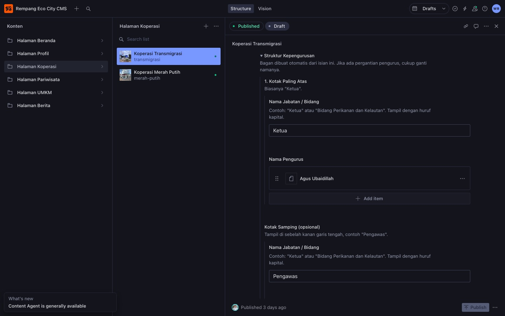

1. **1. Kotak Paling Atas**: biasanya *Ketua*. Wajib diisi lebih dulu sebelum kotak lain.
2. **Kotak Samping (opsional)**: tampil di kanan garis tengah, contoh *Pengawas*.
3. **2. Baris Kedua**: contoh *Sekretaris* dan *Bendahara*. Maksimal 4.
4. **3. Kotak Tengah (opsional)**: contoh *Koordinator Bidang*.
5. **4. Baris Bidang**: kotak-kotak paling bawah. Maksimal 6.

Setiap kotak berisi **Nama Jabatan / Bidang** dan satu atau lebih **Nama Pengurus**:

- Satu nama → ditampilkan di tengah.
- Beberapa nama → ditampilkan sebagai daftar berbutir.
- Nama dengan **Sub-jabatan** (contoh "Manajer") → ditampilkan dengan label jabatan di sampingnya.

Jika ada pergantian pengurus, cukup ganti namanya lalu Publish.

## B6. Halaman Pariwisata

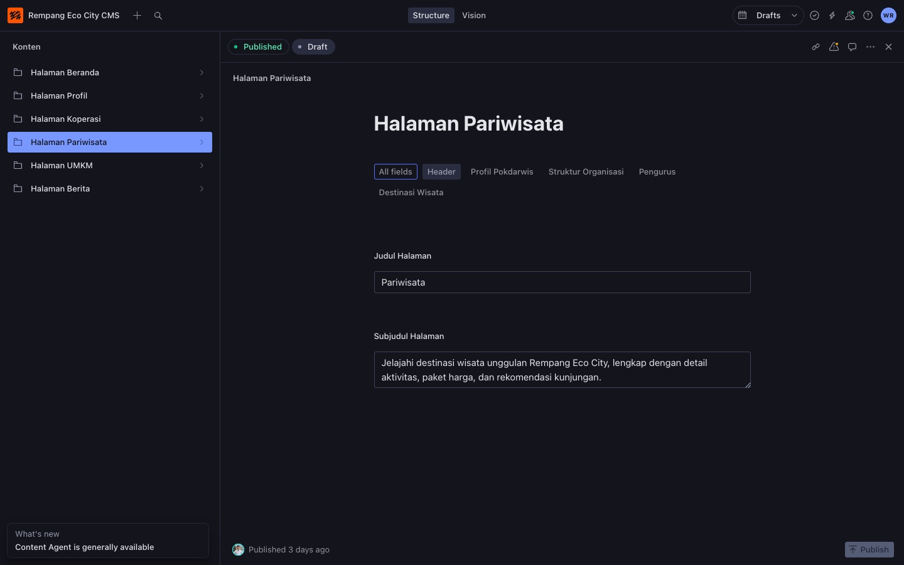

| Tab | Isi |
|---|---|
| **Header** | Judul dan subjudul halaman |
| **Profil Pokdarwis** | Nama Lengkap Kelompok, Nama Singkat (dipakai di judul "Struktur Organisasi …" dan "Pengurus …"), Info Singkat (maksimal 4, disarankan 3), Deskripsi |
| **Struktur Organisasi** | Sama seperti [struktur koperasi](#mengisi-struktur-kepengurusan--organisasi), plus gambar cadangan |
| **Pengurus** | Nama, jabatan, foto (opsional, JPG/PNG, potret). Tanpa foto tampil kotak "Foto". |
| **Destinasi Wisata** | Daftar destinasi. Urutan di daftar = urutan tab di website. |

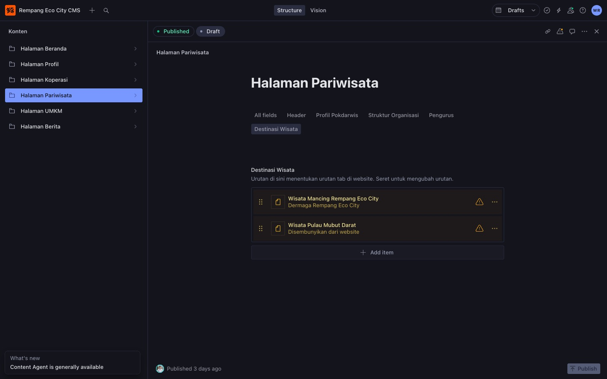

**Setiap destinasi** berisi:

- **Sembunyikan dari website**: untuk destinasi yang belum siap tampil.
- **Kunci Destinasi**: `mancing`, `mangrove`, atau `pulau`. Masing-masing hanya boleh dipakai sekali.
- **Label Tab**: opsional.
- **Nama, Lokasi, Kategori, Ringkasan, Deskripsi, Waktu Terbaik, Fasilitas, Tips**.
- **Galeri Foto & Video**: item pertama menjadi media utama. Video MP4/WebM, usahakan di bawah 50 MB.
- **Link WhatsApp**.
- **Paket & Harga**, misalnya satu paket "Harga Turis" dan satu "Harga Lokal":
  - Label Harga, Nama Paket, Jumlah Peserta, Durasi (jam, opsional).
  - **Rincian Biaya**: setiap item berisi nama, harga (angka saja, tanpa titik, contoh `20000`), satuan, dan keterangan.
    - *Per orang*: dikali jumlah peserta.
    - *Per jam*: dikali durasi.
    - *Per paket*: sekali bayar.
  - **Total Akomodasi**: angka resmi yang tampil di website. Muncul peringatan kuning jika berbeda dari hitungan rincian.

## B7. Halaman UMKM

- **Header Halaman**: judul dan subjudul halaman UMKM. Subjudul juga dipakai sebagai deskripsi di hasil pencarian Google.
- **Daftar UMKM**: satu dokumen per UMKM.

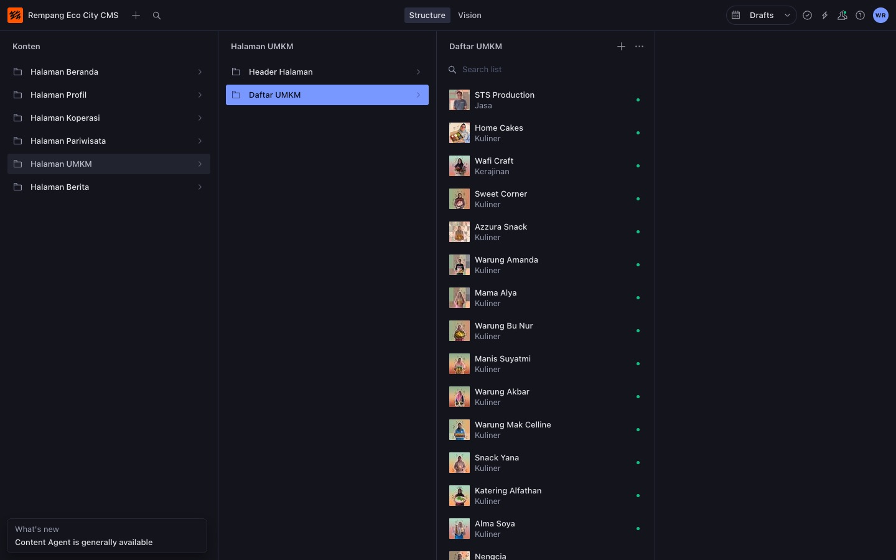

| Kolom | Keterangan |
|---|---|
| Nama UMKM | — |
| Slug | Bagian alamat halaman (`/umkm/[slug]`). Klik **Generate** agar dibuat dari nama. |
| Kategori | Kuliner, Kerajinan, atau Jasa |
| Foto Utama, Deskripsi Singkat (maks. 160), Deskripsi Lengkap | Wajib. |
| Lokasi, Pemilik | Opsional |
| Link WhatsApp | Wajib, contoh `https://wa.me/628xxxxxxxxxx` |
| Link Shopee | Opsional |
| Galeri Foto | Opsional |
| Produk yang Dijual | Nama, harga (teks, contoh "Mulai Rp 20.000"), foto |

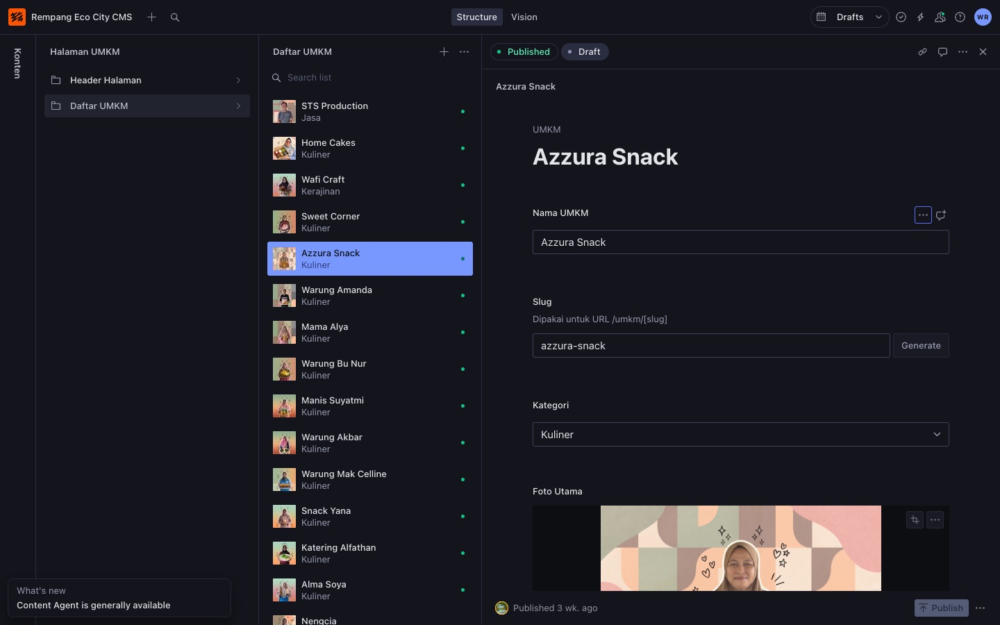

## B8. Halaman Berita

- **Header Halaman**: judul dan subjudul halaman Berita.
- **Daftar Berita**: satu dokumen per berita.

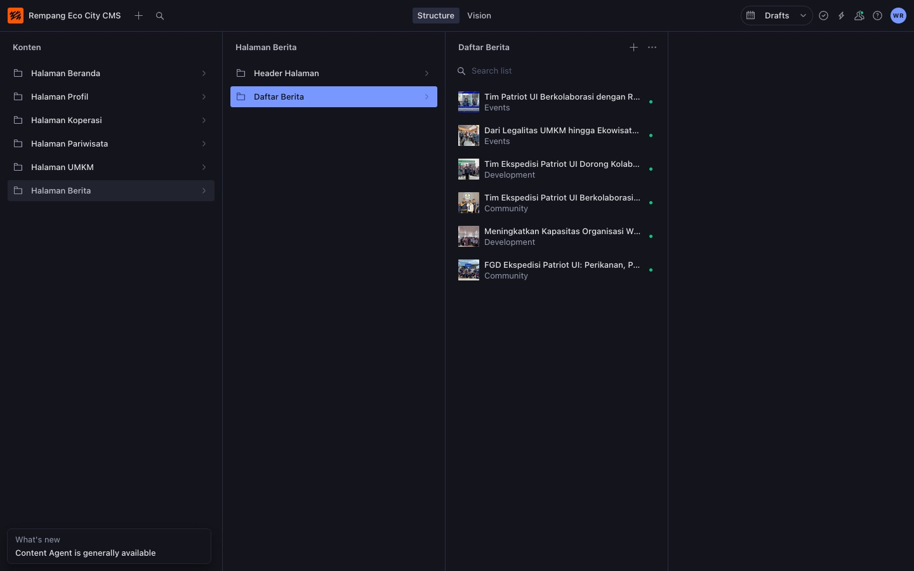

**Menulis berita**

1. Klik **+** di atas Daftar Berita.
2. Isi **Judul**.
3. Pada **Slug**, klik **Generate**. Slug hanya boleh berisi huruf kecil, angka, dan tanda `-` (tanpa spasi). Slug dipakai di alamat `/berita/[slug]`.
4. Pilih **Kategori**: Development, Community, Investment, Sustainability, atau Events.
5. Isi **Tanggal Terbit** (dipakai untuk urutan), **Ringkasan** (maksimal 220 karakter), **Isi Berita**, dan **Gambar Utama**.
6. Klik **Publish**.

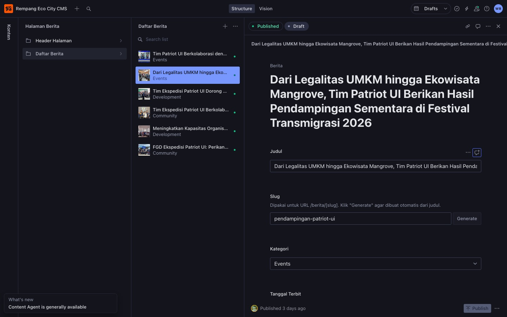

### Featured di Beranda

Section Berita di Beranda menampilkan 4 berita. Aktifkan **Featured di Beranda** agar berita didahulukan di sana; berita featured yang terbaru tampil lebih dulu. Slot yang tersisa diisi berita terbaru lainnya.

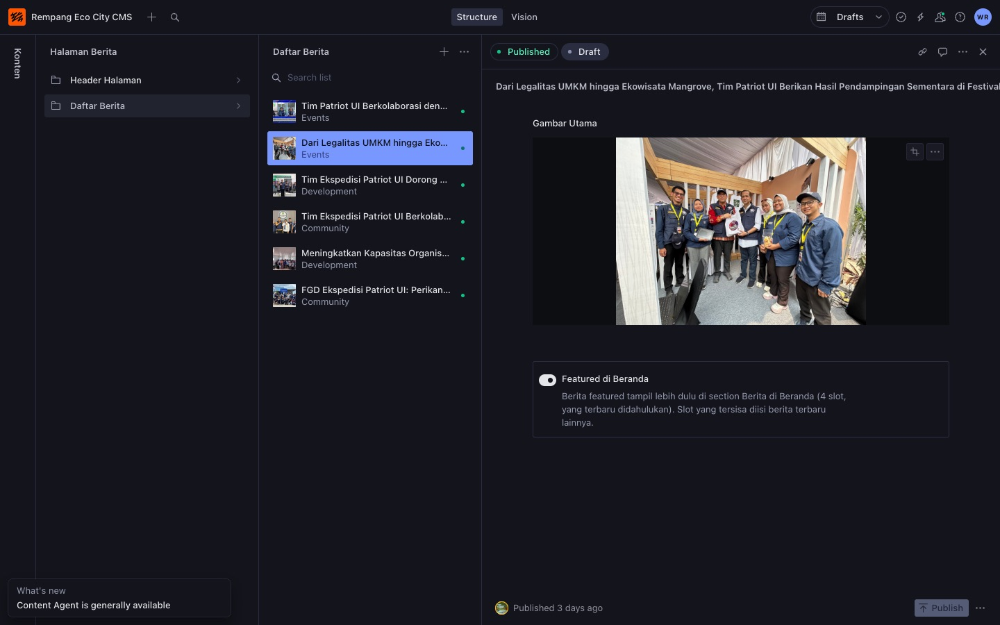

## B9. Masalah yang sering terjadi

| Masalah | Penyebab dan solusi |
|---|---|
| Perubahan belum muncul di website | Pastikan sudah klik **Publish**, bukan hanya tersimpan sebagai draft. Tunggu sekitar 1 menit, lalu muat ulang halaman. |
| Tombol Publish tidak bisa diklik | Ada kolom wajib yang kosong atau salah format (tanda merah). Perbaiki dulu. |
| Berita atau UMKM membuka halaman 404 | Slug berisi spasi atau huruf besar. Klik **Generate** pada Slug, lalu Publish. |
| Lokasi tidak muncul di peta | Koordinat salah format (harus `lintang, bujur`). Atau dokumen belum di-Publish. Atau filter kategori di peta sedang aktif. |
| Titik di peta meleset dari Google Maps | Koordinat diambil dari link share (`@...`). Ambil ulang dengan **klik kanan** di Google Maps. |
| Foto tidak tampil / gagal diunggah | File HEIC atau terlalu besar. Ubah ke JPG. |
| Section hilang dari halaman | Beberapa section sengaja disembunyikan jika datanya kosong, misalnya Fasilitas, Layanan, Laporan Keuangan, Keanggotaan (tanpa link WhatsApp), dan Instagram (tanpa akun). |

---

# Bagian C: Developer

## C1. Teknologi dan struktur

- **Next.js 14** (App Router), TypeScript, Tailwind CSS, Framer Motion, lucide-react.
- **Sanity CMS**. Studio di-embed di route `/studio`.
- **Leaflet** untuk peta. Data kemiringan dari AWS Terrain Tiles (SRTM).

| Folder / file | Isi |
|---|---|
| `app/` | Route: `/`, `/profil`, `/koperasi`, `/koperasi/[routeKey]`, `/pariwisata`, `/umkm`, `/umkm/[slug]`, `/berita`, `/berita/[id]`, `/studio` |
| `components/sections/` | Section Beranda, termasuk `RempangMap.tsx` (peta) dan `slopeLayer.ts` (Tanjakan) |
| `components/pages/` | Isi utama tiap halaman |
| `components/StrukturOrganisasi.tsx` | Bagan struktur dari data CMS |
| `lib/sanity/queries.ts` | Semua query GROQ dan tipe datanya |
| `lib/peta.ts` | Daftar kategori peta |
| `lib/blokRumah.ts` | Data blok rumah dan nomor rumah |
| `lib/features.ts` | Saklar fitur (contoh: menyembunyikan Pariwisata) |
| `sanity/schemaTypes/` | Schema CMS |
| `sanity/structure.ts` | Susunan menu Studio |

## C2. Menjalankan project

1. Buat file `.env.local`:

   ```bash
   NEXT_PUBLIC_SANITY_PROJECT_ID=...
   NEXT_PUBLIC_SANITY_DATASET=production
   SANITY_API_TOKEN=...   # opsional, hanya untuk skrip/maintenance yang menulis data
   ```

   Token API dibuat di [sanity.io/manage](https://www.sanity.io/manage) → project → **API** → **Tokens** (izin Editor). Jangan commit file ini.

2. Install dan jalankan:

   ```bash
   npm install
   npm run dev      # http://localhost:3000 dan http://localhost:3000/studio
   npm run build    # cek build produksi
   ```

## C3. Deploy dan cache

- Data dari Sanity di-cache dengan **ISR selama 60 detik** (`REVALIDATE_SECONDS` di `lib/sanity/queries.ts`).
- Sanity juga memakai CDN. Setelah data diubah lewat API, hasil query bisa tertunda sebentar.
- Saat build lokal, Next.js menyimpan hasil fetch di `.next/cache/fetch-cache`. Jika build lokal menampilkan data lama, hapus folder itu lalu build ulang.
- Kode di-deploy dari repositori GitHub. Perubahan schema baru terlihat di Studio produksi setelah deploy.
- Jika ada perubahan kode **dan** data sekaligus (misalnya kategori peta baru), deploy kodenya lebih dulu. Nilai kategori yang belum dikenal sementara ditampilkan sebagai "Lainnya".

## C4. Perubahan yang sering dibutuhkan

**Menambah kategori peta**

1. `lib/peta.ts`: tambahkan `{ value, title }` di `PETA_KATEGORI_OPTIONS`.
2. `components/sections/RempangMap.tsx`: tambahkan warna dan ikon di `KATEGORI_STYLE`. TypeScript akan error jika lupa.
3. Deploy, lalu pindahkan dokumen yang tadinya "Lainnya" ke kategori baru di Studio.

**Blok rumah**

- Data ada di `lib/blokRumah.ts`.
- Sumbernya anotasi Figma di atas screenshot Google Earth ("Annotated Bigger.svg"), ditempatkan ke koordinat peta dengan mencocokkan jalan OpenStreetMap. Kesalahan posisi bisa beberapa meter.
- Format datanya: `polygon` = `[lat, lng][]`, `houses` = `[lat, lng, nomor][]`.
- Nama blok tampil mulai zoom 17 (`BLOK_LABEL_ZOOM`) dan nomor rumah mulai zoom 18 (`RUMAH_ZOOM`) di `RempangMap.tsx`.

**Menyembunyikan section**

- Ubah nilai di `lib/features.ts`, misalnya `pariwisata: false`.
- Section hilang dari Beranda, Navbar, dan Footer, dan halamannya menampilkan 404. Konten di Sanity tidak terhapus.

**Menambah menu Studio**

- Daftarkan schema di `sanity/schemaTypes/index.ts`.
- Atur posisinya di `MENU` pada `sanity/structure.ts`.

**Mengubah data lewat API (maintenance)**

- Gunakan HTTP API Sanity (`/data/mutate/{dataset}`) dengan `SANITY_API_TOKEN`.
- Untuk dokumen yang sudah tayang, lebih aman membuat draft (`drafts.<id>`) dulu, lalu Publish dari Studio.
